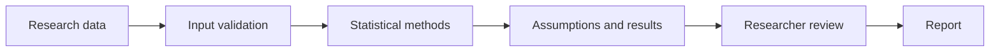

# Conceptual architecture

The original project documentation distinguishes a local Python/FastAPI workstation from a static browser edition. Advanced Python-only methods must not be represented as available in the browser edition. This diagram is conceptual and excludes private implementation details.
